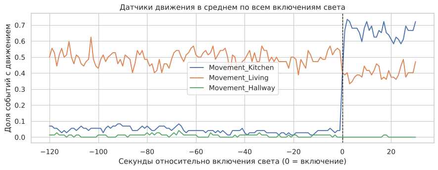
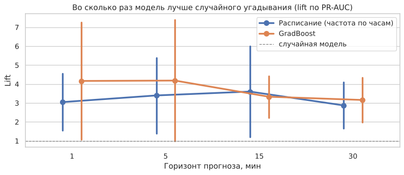
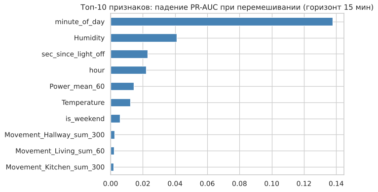

# Умный дом: прогноз включения света на кухне

Проект научной студии «Умный дом» (Центральный университет, 2025). Команда из 3 человек, защита на максимальный балл.
Здесь лежит доработанная версия исследования: исправлена постановка задачи и сделана валидация, устойчивая к утечкам из будущего.

## Задача
Сенсоры умного дома (движение в трёх зонах, мощность, температура, влажность, дверь, приборы) пишут показания раз в секунду.
Цель — перейти от реактивного управления светом к **проактивному**: включать свет на кухне до того, как человек нажмёт выключатель.

**Данные:** 8 дней, ~700 тыс. наблюдений с частотой 1 Гц, 14 столбцов, ~5% пропусков в четырёх датчиках, искусственные выбросы.

## Что сделано
1. **EDA на уровне событий.** За 8 дней свет включался всего 72 раза. Состояние сильно инерционно: через минуту
   оно совпадает с текущим в 98.8% секунд. Поэтому посекундные метрики почти ничего не говорят о качестве прогноза.
2. **Предобработка без утечек.** Аномалии отсекаются по физическим границам, а не по IQR: IQR вырезал бы реальные
   включения чайника. Пропуски заполняются только по прошлым значениям (EMA и forward fill).
3. **Признаки:** лаги, скользящие суммы и статистики (10 с / 1 мин / 5 мин), время с последнего движения в каждой зоне,
   время с последнего выключения света, время суток.
4. **Эксперимент 1: исходная постановка** (состояние света в текущую секунду).
   ROC-AUC ≈ 1.0, но правило из одного признака («было ли движение на кухне за 5 минут») даёт 0.988.
   Модель распознаёт ситуацию, а не прогнозирует её.
5. **Анализ предвестников.** Движение на кухне появляется одновременно со светом (медианная задержка 1 с),
   а в гостиной и коридоре перед включением активность не меняется:

   

6. **Эксперимент 2: прогноз «включится ли свет в ближайшие H минут»** для H = 1, 5, 15, 30 минут.
   Валидация `TimeSeriesSplit` (4 фолда), метрика PR-AUC (классы несбалансированы), сравнение с бейзлайном «по расписанию».

## Результаты

| Горизонт | Доля положительных | PR-AUC «расписание» | PR-AUC бустинг | ROC-AUC «расписание» | ROC-AUC бустинг |
|---|---|---|---|---|---|
| 1 мин  | 0.009 | 0.023 | 0.030 | 0.725 | 0.725 |
| 5 мин  | 0.042 | 0.120 | 0.140 | 0.738 | 0.773 |
| 15 мин | 0.116 | 0.336 | 0.344 | 0.761 | 0.830 |
| 30 мин | 0.203 | 0.518 | 0.573 | 0.804 | 0.859 |

**Выводы**
- За минуту включение света предсказать практически нельзя: в данных нет краткосрочных предвестников.
- Основной источник предсказуемости — распорядок дня. Простой бейзлайн «частота включений по часам» уже даёт
  трёхкратный выигрыш над случайным угадыванием. Градиентный бустинг сопоставим с ним по PR-AUC, но лучше по ROC-AUC
  (0.83 против 0.76 на 15 минутах) и в 2–3 раза стабильнее между периодами.
- **Рекомендация:** включать свет реактивно по датчику движения, а прогноз на 15–30 минут использовать
  для сценариев, где нужна подготовка заранее (климат, режимы энергопотребления).

**Ограничения:** мало данных (8 дней, 72 включения), и данные, по-видимому, синтетические. Влажность и температура частично
работают как «косвенные часы», и на реальном доме это может не перенестись.

## Стек
Python, pandas, NumPy, scikit-learn (HistGradientBoosting, LogisticRegression, TimeSeriesSplit, permutation importance), matplotlib, seaborn.

## Как запустить
1. Положите `train_data.csv` рядом с ноутбуком (или поменяйте `DATA_PATH` в первой ячейке с загрузкой).
2. `pip install pandas numpy scikit-learn matplotlib seaborn`
3. Запустите `smart_home_lighting.ipynb`. Полный прогон занимает около 6 минут на ноутбуке.

## Файлы
- `smart_home_lighting.ipynb` — ноутбук с кодом и результатами
- `report.pdf` — статья по первой версии проекта (исходная постановка)
- - *.png — графики для README
